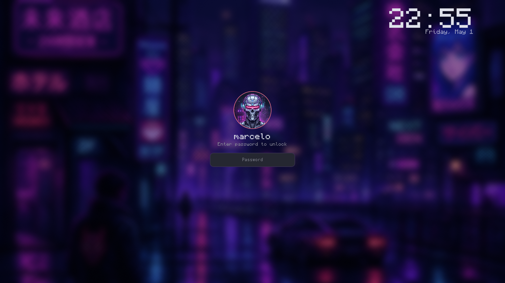

# Arch Linux Dotfiles

Hyprland (Wayland) setup with a unified dark neon palette across waybar, wofi,
kitty and a custom SDDM theme (which is also the lock screen). Tokyo-Night-ish surfaces, cyberpunk
pink/purple accents, Monocraft + Nerd Font typography.




> Drop the matching PNGs into `screenshots/` — see `screenshots/README.md` for capture commands.

---

## Layout

User-level configs use a [GNU Stow](https://www.gnu.org/software/stow/) style
layout: each top-level dir is a "package" whose contents mirror your `$HOME`.

| Package | What it ships | Stowed to |
|---|---|---|
| `hypr/` | Hyprland config, hypridle config, helper scripts | `~/.config/hypr/` |
| `waybar/` | Bar config, CSS, scripts | `~/.config/waybar/` |
| `wofi/` | Launcher + powermenu | `~/.config/wofi/` |
| `kitty/` | Terminal config | `~/.config/kitty/` |
| `yazi/` | File manager | `~/.config/yazi/` |
| `gtk/` | GTK 2/3/4 dark theme + cursor settings | `~/.gtkrc-2.0`, `~/.config/gtk-{3,4}.0/` (`--no-folding`) |
| `shell/` | `.bashrc`, `.zshrc`, `.xprofile`, etc. | `$HOME` |
| `nvidia/` | "Google Chrome (NVIDIA)" / "Steam (NVIDIA)" launchers + `chrome-nvidia` script | `~/.local/share/applications/`, `~/.local/bin/` |
| `wallpapers/` | Wallpaper images (rotated by `awww-daemon`) | `~/wallpapers/` |
| `sddm/` | Custom SDDM login theme — **system-level**, not stowed | see `sddm/README.md` |
| `system/` | System files copied by `install.sh` (e.g. Xorg tweak for hybrid GPUs) | `/etc/...` |

---

## Quick install

```bash
git clone https://github.com/MarceloSavian/arch.git ~/arch
~/arch/install.sh
```

Run it in a real terminal as your normal user (it asks for your sudo password).
It is idempotent, so re-running it after a `git pull` is safe. It:

1. enables **multilib** (Steam / 32-bit drivers)
2. installs every package below (plus NVIDIA drivers when an NVIDIA GPU is detected)
3. bootstraps **yay** and installs the AUR packages
4. backs up conflicting dotfiles to `~/dotfiles-backup-<timestamp>/` and stows the packages
5. installs the SDDM theme and the hybrid-GPU Xorg tweak
6. enables services: sddm, bluetooth, NetworkManager, nordvpnd, PipeWire (user)
7. sets defaults: Chrome as browser, Thunar for folders, dark GTK theme
8. validates the Hyprland config

`install.sh` is the source of truth for the package list.

After it finishes: reboot, then `nordvpn login` and (to push this repo)
`gh auth login && gh auth setup-git`.

Reboot (or `sudo systemctl restart sddm` from a TTY) and you're in.

---

## What each package does

### Wayland / compositor

| Package | Purpose |
|---|---|
| `hyprland` | Wayland compositor |
| `hypridle` | Lock/unlock events: locks before sleep, restores your workspace when you log back in |
| `awww` | Wallpaper daemon (`awww-daemon` rotates `~/wallpapers/` every 10 min) |

### Bar / launchers / shell

| Package | Purpose |
|---|---|
| `waybar` | Top status bar (sketchybar-style pill modules) |
| `wofi` | App launcher + powermenu (bound to `SUPER+D` / `SUPER+B`) |
| `swaync` | Notification daemon |
| `kitty` | Terminal |
| `yazi` | TUI file manager (bound to `SUPER+E`) |

### Audio

| Package | Purpose |
|---|---|
| `pipewire` + `wireplumber` | Sound server + session manager (no sound without both) |
| `pipewire-pulse` | PulseAudio API: `pactl`, waybar volume, pavucontrol, Chrome |
| `pipewire-alsa` | Apps that talk to ALSA directly |

### Apps

| Package | Purpose |
|---|---|
| `google-chrome` (AUR) | Default browser |
| `spotify` (AUR) | Music; the waybar media pills control it |
| `nordvpn-bin` (AUR) | VPN; waybar pill + wofi connect menu (`nordvpnd` service, `nordvpn` group) |
| `steam` (multilib) | Games; use the **Steam (NVIDIA)** launcher on hybrid laptops |
| `github-cli` | `gh auth` for pushing this repo |

### Login

| Package | Purpose |
|---|---|
| `sddm` | Display manager that renders the login theme in `sddm/cyberpunk-mr/` |
| `qt5-graphicaleffects` | Required for blur / fancy effects in the SDDM theme |

### Utilities pulled in by keybinds / scripts

| Package | What it's for |
|---|---|
| `grim` + `slurp` + `swappy` + `hyprpicker` | Screenshots (hyprpicker freezes the screen) |
| `wl-clipboard` + `cliphist` | Clipboard history |
| `brightnessctl` | Brightness keys |
| `playerctl` | Media keys |
| `pavucontrol` | GUI audio mixer |
| `polkit-kde-agent` | Auth prompts (sudo dialogs) |
| `tesseract` | OCR for `SUPER+O` (screenshot → clipboard text) |
| `bluez` + `bluez-utils` + `blueman` | Bluetooth stack, `bluetoothctl`, tray/manager |
| `network-manager-applet` | Network tray |
| `bibata-cursor-theme` | Cursor theme |

### Fonts

The whole UI assumes:

- `otf-monocraft` (AUR) — primary UI font
- `ttf-input-nerd` (Nerd Font variant of Input Mono) — fallback + glyphs
- `ttf-jetbrains-mono-nerd` — kitty
- `otf-font-awesome` — waybar icon glyphs
- `ttf-material-icons` — spotify / memory pills

If a font is missing, waybar / wofi will fall back silently but icons may render as tofu.

---

## Manual / per-machine bits

### `awww` wallpaper daemon

`hypr/.config/hypr/scripts/rotate-wallpaper.sh` rotates `~/wallpapers/` every
10 minutes. Adjust `INTERVAL` inside the script.

### Display layout

`hypr/.config/hypr/modules/monitors.lua` hardcodes two monitors:

```lua
hl.monitor({ output = "HDMI-A-1", mode = "2560x1440@144", position = "1920x0", scale = 1 })
hl.monitor({ output = "eDP-1",    mode = "1920x1080@60",  position = "0x0",    scale = 1 })
```

Edit those lines or replace with `hl.monitor({ output = "", mode = "preferred", position = "auto", scale = 1 })` for autodetect.

### NVIDIA env vars

Apps render on the integrated GPU by default so a hybrid laptop's NVIDIA
card can power down. Run games / heavy apps on NVIDIA with `prime-run <app>`
(package `nvidia-prime`).

The `nvidia/` package adds launcher entries for wofi (SUPER+D):

- **Google Chrome (NVIDIA)** runs `prime-run google-chrome-stable --ozone-platform=x11`.
  Chrome has to go through XWayland: on native Wayland it stays on the iGPU, and
  forcing it (`--render-node-override`) crashes Hyprland. Chrome is single-instance,
  so close the normal Chrome first (the launcher tells you if it's running).
- **Steam (NVIDIA)** runs `prime-run steam`; every game launched from it inherits
  the NVIDIA offload. Hidden until Steam is installed.

Note: `nvidia-smi` does not list Chrome's sandboxed GPU process. To verify, open
`chrome://gpu` and check the GL_RENDERER line.

### Hyprland config (Lua)

The Hyprland config uses the Lua format (Hyprland 0.57+): `hyprland.lua`
just `require`s the files in `modules/` (env, monitors, autostart, look,
input, rules, binds). Validate after editing with:

```bash
Hyprland --verify-config -c ~/.config/hypr/hyprland.lua
```

---

## Reproducing this setup with an AI

Point the agent at [`AGENTS.md`](AGENTS.md): it has the hardware facts,
conventions and the pitfalls already hit on this machine (things that crash
Hyprland, commands that kill the user's apps, renamed packages, ...).

---

## Keybinds cheatsheet

> **Left Alt and Left Ctrl are swapped** (`ctrl:swap_lalt_lctl`, Mac-style ⌘C/⌘V).
> Binds written as `CTRL` below are pressed with the physical **Left Alt** key.

| Keys | Action |
|---|---|
| `SUPER+RETURN` | Open kitty |
| `SUPER+Q` | Close window |
| `CTRL+Q` | Lock — goes to the same SDDM login screen as at boot (↑↓ picks a user). Power menu → Lock and suspend lead there too. |
| `SUPER+D` | App launcher (wofi) |
| `SUPER+B` | Power menu |
| `SUPER+E` | File manager (yazi in kitty) |
| `SUPER+W` | Workspace overview (eww) |
| `SUPER+SHIFT+W` | Shuffle wallpaper |
| `SUPER+O` | OCR screenshot region → clipboard |
| `SUPER+PRINT` | Freeze screen, select region → save to `~/Pictures/screenshots/` |
| `PRINT` | Freeze screen, select region → clipboard |
| `CTRL+PRINT` | Select region → annotate in swappy |
| `CTRL+SHIFT+4` | Quick region screenshot to `~/Pictures/Screenshots/` |
| `SUPER+SHIFT+R` | Reload Hyprland |
| `SUPER+SHIFT+H` | Toggle gaps + rounding |
| `SUPER+R` | Resize mode (arrows, `ESC` to exit) |
| `SUPER+V` | Clipboard history |
| `SUPER+N` | Notification center |
| `SUPER+1..9,0` | Jump to workspace |
| `SUPER+SHIFT+1..9,0` | Move window to workspace |
